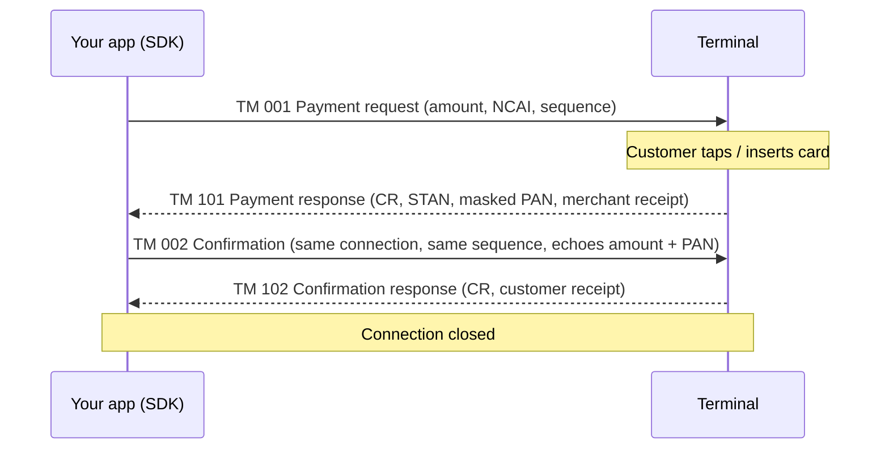

# react-native-tkpay-naps

> Part of the NAPS SDK family. All of them speak the same M2M TLV protocol to the same terminals.
> The **[C# SDK](https://github.com/Belkouche/tkpay-sdk-pos-naps-csharp) is canonical**
> (reference implementation); this is the React Native port. Siblings:
> [Node.js](https://github.com/Belkouche/aslan-naps-node) ·
> [Android](https://github.com/Belkouche/tkpay-sdk-pos-android) ·
> [iOS](https://github.com/Belkouche/tkpay-sdk-pos-ios).
> Test without hardware using the [emulator](https://github.com/Belkouche/tkpay-naps-emulator).

React Native SDK that lets a cash-register app (the "ECR") take card payments on a NAPS Pay
payment terminal. Your app sends the amount, the customer pays on the terminal, and the SDK
returns the result: approval or decline, STAN, masked card number and printable receipts.
It also voids payments and runs the terminal's maintenance operations.

It implements the NapsPay ECR TLV protocol v2.0 as run by NapsPay v5.4.4, on iOS and Android, with TypeScript types.

## Contents

1. [Supported terminals and connections](#supported-terminals-and-connections)
2. [Install](#install)
3. [Quickstart](#quickstart)
4. [How a payment works](#how-a-payment-works)
5. [How a void works](#how-a-void-works)
6. [Other operations](#other-operations)
7. [Receipts](#receipts)
8. [Card number masking](#card-number-masking)
9. [Response codes](#response-codes)
10. [Errors and timeouts](#errors-and-timeouts)
11. [Network traffic](#network-traffic)
12. [Testing with the emulator](#testing-with-the-emulator)
13. [Troubleshooting](#troubleshooting)
14. [Changelog](#changelog)

---

## Supported terminals and connections

The SDK connects to the terminal over **TCP/IP (Wi‑Fi), port 4444**. The NapsPay app on the
terminal listens on that port; your phone or tablet must be on the same network.

| Terminal (spec §2) | Connections the terminal offers | Supported by this SDK |
|---|---|---|
| Sunmi P2 | Wi‑Fi TCP 4444, USB | Wi‑Fi TCP |
| Sunmi P3 | Wi‑Fi TCP 4444, USB | Wi‑Fi TCP |
| Sunmi P2 Smart PAD | Wi‑Fi TCP 4444, USB | Wi‑Fi TCP |
| Ingenico Self 5000 | USB only | No |
| Ingenico Lane 3600 | USB only | No |

USB is not implemented in this SDK. For a USB link (including the Ingenico terminals), use
the [C# SDK](https://github.com/Belkouche/tkpay-sdk-pos-naps-csharp), which has a USB serial transport.

Requirements: React Native 0.60+, iOS 12.0+, Android with the `INTERNET` permission.

---

## Install

```bash
npm install github:Belkouche/tkpay-sdk-pos-rn
# or
yarn add github:Belkouche/tkpay-sdk-pos-rn
```

**iOS**

```bash
cd ios && pod install
```

On iOS 14+, talking to a device on the local network shows the system's local-network
permission prompt. Add an `NSLocalNetworkUsageDescription` string to `Info.plist`.

**Android**: the native module auto-links. Make sure `AndroidManifest.xml` has:

```xml
<uses-permission android:name="android.permission.INTERNET" />
```

Rebuild the app after installing. Native code means Expo Go will not work; use a development build.

---

## Quickstart

Connect, pay 10.50 MAD, check the result, print the customer receipt:

```typescript
import { NapsPayClient, receiptToPlainText } from 'react-native-tkpay-naps';

const client = new NapsPayClient({ host: '127.0.0.1', port: 4444 }); // terminal IP; 127.0.0.1 = emulator

async function main() {
  const result = await client.processPayment({ amount: 10.5, registerId: '01', cashierId: '00001' });

  if (result.success) {
    console.log(`Approved: STAN ${result.stan}, card ${result.maskedCardNumber}`);
    if (result.customerReceipt) console.log(receiptToPlainText(result.customerReceipt));
  } else {
    console.log(`Declined: CR ${result.responseCode} (${result.error})`);
  }
}

main().catch((e) => console.error(`Payment error: ${e.code} ${e.message}`));
```

- `host` is the terminal's IP address (shown in the terminal's network settings). Use `127.0.0.1` with the emulator.
- `registerId` (2 digits) and `cashierId` (5 digits) identify your till; together they form the NCAI field.
- On a real terminal, run [`referencing()`](#referencing) once before the first payment.

The same code runs under Node against the emulator. See [`example/quickstart/quickstart.js`](example/quickstart/quickstart.js) and [Testing with the emulator](#testing-with-the-emulator).

---

## How a payment works

A payment is **two request/response exchanges on the same TCP connection**. `processPayment()`
does both for you.



1. **TM 001 → 101.** The SDK sends the amount (in centimes), NCAI, sequence number, currency
   (504 = MAD) and the date/time, then waits up to `timeout` (default 120 s) while the customer
   pays. CR `000` in TM 101 means the card was authorised.
2. **TM 002 → 102.** On the same connection, the SDK confirms the transaction, echoing the amount,
   masked PAN and card expiry from TM 101. It waits up to `confirmationTimeout` (default 40 s).
   CR `000` in TM 102 completes the payment.

`result.success` is `true` only if **both** responses return CR `000`. A decline in TM 101 skips
the confirmation. If the terminal refuses the confirmation (TM 102 with CR ≠ 000, for example
`482` when it has auto-reversed), the result is a failure too.

**`PaymentResult`**

```typescript
{
  success: boolean,          // true only when TM 101 and TM 102 both returned CR 000
  responseCode: string,      // CR of the failing step, or "000"
  stan?: string,             // System Trace Audit Number: keep it to void the payment
  maskedCardNumber?: string, // e.g. "516794******3315"
  cardExpiry?: string,       // YYMM
  cardholderName?: string,
  entryMode?: string,
  authNumber?: string,
  ncai?: string,
  sequence?: string,         // keep it to void the payment
  transactionDate?: string,  // DDMMYYYY
  transactionTime?: string,  // HHMMSS
  merchantReceipt?: Receipt, // from TM 101 (or the decline receipt)
  customerReceipt?: Receipt, // from TM 102
  error?: string,            // human-readable reason when success is false
}
```

The `sequence` is generated by the client (000001, 000002, …) unless you pass `sequence` in the request.

---

## How a void works

A void (cancellation) of an approved payment is also **two exchanges on one connection**.
`cancelPayment()` does both.

```mermaid
sequenceDiagram
    participant App as Your app (SDK)
    participant T as Terminal
    App->>T: TM 003 Cancellation (new sequence NS; STAN, amount and sequence (NSA) of the sale)
    T-->>App: TM 103 (CR 000 = sale found; amount, maybe the merchant void receipt)
    App->>T: TM 004 Cancellation confirmation (same connection, same NS as TM 003, echoes amount)
    T-->>App: TM 104 (CR 480 or 000 = void done; void STAN, void receipt)
```

- **Frames (spec v2 §4.3/§4.4).** TM 003: TM, NCAI, NS, DA, HE, DATR, HETR, STAN, MT, NSA. The
  void gets its own new sequence (NS); the `sequence` you pass is the sale's and goes in NSA.
  TM 004: TM, NCAI, NS (same as TM 003), STAN, MT and DE (echoed from TM 103), DATR and HETR
  (echoed from TM 103), DA, HE. TM 004 never carries NSA.
- **TM 103 with CR 000 only means the sale was found.** The reversal is executed by TM 004.
- **TM 104 with CR 480 or 000:** the void is done. `success: true`.
- **TM 104 with CR 995, or no TM 104 within `confirmationTimeout`:** the outcome is unknown.
  `success: false` and `pendingConfirmation: true`, with the STAN and the TM 103 merchant receipt.
  **Do not treat this as voided, and do not treat it as failed.** Verify by printing a duplicate
  receipt for the sale's STAN.
- **Any other result** (TM 103 refused, e.g. 302 not found or 482 already cancelled, or a TM 104
  refusal): `success: false`, no `pendingConfirmation`. The payment is not voided.
- **Receipts.** If TM 103 carries a receipt, it is the merchant copy and the TM 104 receipt is the
  customer copy. If TM 103 has no receipt and TM 104 has one (the Sunmi P2 prints it
  "Copie Commerçant"; the Ingenico Lane3600 does the same), the TM 104 receipt is returned as
  `merchantReceipt` and there is no `customerReceipt`.

```typescript
import { NapsPayClient, type PaymentResult } from 'react-native-tkpay-naps';

async function voidPayment(client: NapsPayClient, payment: PaymentResult, amount: number) {
  const result = await client.cancelPayment(
    payment.stan!,             // STAN of the sale to void
    '01',                      // same register as the sale
    '00001',                   // same cashier as the sale
    payment.sequence!,         // sequence of the sale (sent as NSA; the void gets its own NS)
    Math.round(amount * 100),  // sale amount in centimes (required by NapsPay v5.4.4)
  );

  if (result.success) {
    console.log(`Voided (CR ${result.responseCode}), void STAN ${result.stan}`);
    return 'voided';
  }

  if (result.pendingConfirmation) {
    // Unknown outcome: reprint the sale's receipt and check it before doing anything else.
    const dup = await client.printDuplicate('01', '00001', payment.stan);
    console.log(`Void unconfirmed (${result.error}). Duplicate CR ${dup.responseCode}`);
    return 'pending';
  }

  console.log(`Void failed: CR ${result.responseCode} (${result.error})`);
  return 'failed';
}
```

Voids must be done before end-of-day settlement. A void of an already-voided sale returns CR 482.

**`CancellationResult`**

```typescript
{
  success: boolean,              // true for TM 104 CR 480 or 000
  responseCode: string,
  stan?: string,                 // void STAN from TM 104, else the TM 103 STAN
  merchantReceipt?: Receipt,     // void receipt, merchant copy (TM 103, or TM 104 if TM 103 has none)
  customerReceipt?: Receipt,     // void receipt, customer copy (TM 104, only when TM 103 had a receipt)
  pendingConfirmation?: boolean, // TM 104 CR 995 or no TM 104: outcome unknown
  error?: string,
}
```

---

## Other operations

Each one opens a connection, sends one request and returns the parsed answer. They never throw:
a transport error comes back as `success: false` with `responseCode: ''` and `error` set.

### `networkTest`

TM 009 is **not supported over TCP**, the only connection of this SDK. `networkTest()` sends
nothing and returns `success: false` with `responseCode: 'UNSUPPORTED'`: the NapsPay app on
Sunmi terminals does not implement TM 009 (it answers TM 101 with CR 902), and a test frame
crashed the app on a Sunmi P2. The network test is for USB links (C# and Node SDKs). To check
that the terminal is reachable, use `testConnection()`.

```typescript
const net = await client.networkTest('01', '00001');
// { success: false, responseCode: 'UNSUPPORTED', error: 'Network test not supported over TCP (...)' }
```

### `referencing`

TM 013. Loads the terminal's parameter set from the server. Run it once before the first payment,
and again after a terminal swap or configuration change.

```typescript
import { TIDE } from 'react-native-tkpay-naps';

const ref = await client.referencing('01', '00001');                    // merchant set ("01")
const recharge = await client.referencing('01', '00001', TIDE.RECHARGE); // recharge set ("02")
console.log(ref.success, ref.parameterSet, ref.receipt);
```

### `printDuplicate`

TM 008. Reprints a receipt: the last transaction, or a given STAN.

```typescript
const last = await client.printDuplicate('01', '00001');
const sale = await client.printDuplicate('01', '00001', '000042');
if (sale.success && sale.merchantReceipt) console.log(receiptToPlainText(sale.merchantReceipt));
```

### `totals`

TM 010 (Payment Totals, spec v2.0 §4.7). Returns the terminal's daily totals ticket. It closes no batch.

```typescript
const tot = await client.totals('01', '00001');
if (tot.success && tot.receipt) console.log(receiptToPlainText(tot.receipt));
```

### `settlement`

Deprecated. Télécollecte is not part of the NapsPay ECR protocol: spec v2.0 §4.7 defines TM 010 as
Payment Totals, not settlement. Run the télécollecte from the terminal's menu. `settlement()` sends
nothing and returns `success: false`, `responseCode: 'UNSUPPORTED'`. Use `totals()` for the daily
totals ticket.

### `resetPinPad`

TM 012. Brings the terminal back to its idle "Attente Caisse" screen.

```typescript
const reset = await client.resetPinPad('01', '00001');
console.log(reset.success ? 'Terminal reset' : reset.error);
```

### `testConnection`

TCP only: opens and closes a socket (5 s timeout), no protocol message.

```typescript
const reachable = await client.testConnection();
```

---

## Receipts

The receipt is the DP block (tag 010) the terminal sends: a CMI-certified layout that your app
prints as received. The SDK parses **every** line, in order, and never adds, removes, merges or
rewrites one. The only change it makes is masking a full card number if one ever appears in the
text (see [Card number masking](#card-number-masking)).

Each DP line has four sub-tags (spec §5): DP1 line number (030), DP2 format (031, `S` normal or
`G` bold), DP3 alignment (032, `C` centre, `D` right, `G` left) and DP4 text (033). Lines are
separated by `*` and `?` ends the block. They become:

```typescript
interface Receipt {
  type: ReceiptType;    // MERCHANT or CUSTOMER
  lines: ReceiptLine[]; // { lineNumber: "00", text: "TKpay", bold: true, alignment: CENTER }
}
```

**Which copy comes from where**

| Operation | Result field | Comes from |
|---|---|---|
| `processPayment` | `merchantReceipt` ("Copie Commercant") | TM 101 |
| `processPayment` | `customerReceipt` ("Copie Client") | TM 102 |
| `processPayment` declined | `merchantReceipt` | decline receipt, as sent |
| `cancelPayment` | `merchantReceipt` (ends "ANNULATION", "Copie Commercant") | TM 103, also kept on a pending void; TM 104 when TM 103 has no receipt |
| `cancelPayment` | `customerReceipt` (ends "ANNULATION", "Copie Client") | TM 104, only when TM 103 had a receipt |
| `printDuplicate` | `merchantReceipt` | TM 108, as sent |
| `totals` | `receipt` | TM 110, as sent |
| `referencing` | `receipt` | TM 113, as sent |

**Printing a copy**

`receiptToPlainText(receipt, width = 40)` renders the lines as text, applying centre and right
alignment. For a printer that supports styles, use each line's `bold` and `alignment` instead.

```typescript
import { Alignment, receiptToPlainText, type Receipt } from 'react-native-tkpay-naps';

async function printBothCopies() {
  const payment = await client.processPayment({ amount: 10, registerId: '01', cashierId: '00001' });
  if (payment.merchantReceipt) console.log(receiptToPlainText(payment.merchantReceipt)); // keep
  if (payment.customerReceipt) console.log(receiptToPlainText(payment.customerReceipt)); // hand over
}

// Styled printing: one call per line with its own bold / alignment
function printStyled(receipt: Receipt, printLine: (text: string, bold: boolean, align: Alignment) => void) {
  for (const line of receipt.lines) printLine(line.text, line.bold, line.alignment);
}
```

A 10.00 MAD payment on the emulator gives this customer copy (each line trimmed):

```text
TKpay
--------------------------------
07/11/2026 00:11:30
TKPAY DEMO
CASABLANCA
--------------------------------
VISA
516794******3315
Terminal: 00000001
Transaction: 522544
Autorisation: 517705
STAN: 522544
--------------------------------
MONTANT: 10.00 MAD
--------------------------------
DEBIT
Copie Client
```

The merchant copy is the same with `Copie Commercant` as the last line. Void copies have
`ANNULATION` in place of `DEBIT`.

---

## Card number masking

Card numbers are masked to **first 6 + last 4 digits** (`516794******3315`). The full number is
never exposed or logged by the SDK.

Masking happens in the native module (Android and iOS), on the terminal's reply, before it is
passed to JavaScript; the JavaScript layer masks again when it parses the reply.

- **Card number field (NCAR, tag 007):** always returned as first 6 digits, `*`, last 4 digits
  (`516794******3315`), whatever grouping it arrived in.
- **Receipt text:** any run of 13 or more digits, where consecutive digits are adjacent or separated
  by exactly one space, dash, dot, tab or non-breaking space, has every digit masked except the
  first 6 and last 4 of the run (`5167 9400 0012 3315` → `5167 94** **** 3315`). Longer runs are
  masked the same way. Separators and the line layout are kept. Dates and times, amounts, STAN,
  terminal and authorisation numbers, and any run shorter than 13 digits are left as sent.

Both helpers are exported:

```typescript
import { maskCardNumber, maskCardNumbersInText } from 'react-native-tkpay-naps';

maskCardNumber('5167940123453315');                     // "516794******3315"
maskCardNumbersInText('CARTE 5167 9401 2345 3315');     // "CARTE 5167 94** **** 3315"
```

---

## Response codes

Every response carries a CR (tag 013). `000` means success. The full table (spec §6 and the
NapsPay ISO list) is exported as `RESPONSE_CODES`, with helpers:

```typescript
import { describeResponseCode, isApproved, RESPONSE_CODES } from 'react-native-tkpay-naps';

describeResponseCode('116');   // "Insufficient funds"
describeResponseCode('482');   // "Transaction already cancelled"
isApproved('001');             // true: 000, 001, 003 and 007 are approval codes
```

`processPayment()` itself treats only `000` as success. Failed payments put
`describeResponseCode()`'s text in `result.error`, with a few specific messages (909 "Terminal or
server is down", 302 "Transaction not found", 482 "Transaction already cancelled", 480 "Transaction cancelled").

Codes you will meet most often:

| CR | Meaning |
|---|---|
| 000 | Approved / OK |
| 100 | Do not honour (declined) |
| 116 | Insufficient funds |
| 117 | Incorrect PIN |
| 302 | Record not found (unknown STAN) |
| 480 | Reversal accepted (void done, in TM 104) |
| 482 | Transaction already cancelled |
| 909 | System failure (terminal or server down) |
| 995 | Server processing error (TM 104: void outcome unknown) |

---

## Errors and timeouts

**Configuration** (`new NapsPayClient(config)`):

| Option | Default | Used for |
|---|---|---|
| `host` | (required) | Terminal IP address |
| `port` | `4444` | Terminal TCP port |
| `timeout` | `120000` ms | Opening the connection and waiting for the first response (customer paying), and every single-request operation |
| `confirmationTimeout` | `40000` ms | Waiting for TM 102 / TM 104 on the same connection |
| `protocolVersion` | `ProtocolVersion.V2` | Expected terminator: `!` (v2, NapsPay v5.4.4) or `?` (v1). The SDK accepts both either way. |

Timeouts under 1000 ms are raised to 1000 ms, with a console warning.

**`processPayment()` throws** a `NapsError` (with `code` from `ErrorCode`) when there is no usable answer:

| `error.code` | When |
|---|---|
| `INVALID_RESPONSE` | Request rejected before sending (amount ≤ 0, `registerId` not 2 characters, `cashierId` not 5), a response without CR or STAN, or a reply over 64 KB |
| `TIMEOUT` | The native error message contains "timeout" |
| `CONNECTION_FAILED` | The native error message contains "connect" or "connection" |
| `UNKNOWN_ERROR` | Anything else. On Android a read timeout reports "Read timed out" and lands here. |

A **decline is not an exception**: it returns `success: false` with the CR.

**The other methods never throw.** Transport errors come back as `success: false`, `responseCode: ''`
and the message in `error`. `cancelPayment()` maps a timeout waiting for TM 104 to `pendingConfirmation`.

```typescript
import { NapsError, ErrorCode } from 'react-native-tkpay-naps';

try {
  const result = await client.processPayment({ amount: 25, registerId: '01', cashierId: '00001' });
  if (!result.success) console.log(`Declined: ${result.error}`);
} catch (e) {
  if (e instanceof NapsError && e.code === ErrorCode.TIMEOUT) console.log('No answer from the terminal');
  else throw e;
}
```

---

## Network traffic

The SDK only talks to the terminal. It sends nothing to any server.

---

## Testing with the emulator

The [NAPS emulator](https://github.com/Belkouche/tkpay-naps-emulator) is a Python (standard library)
terminal that speaks the same protocol. Start it:

```bash
python3 ../tkpay-naps-emulator/naps_emulator.py --port 4444
```

Useful `--mode` values:

| Mode | Behaviour |
|---|---|
| `approve` (default) | Approves payments, voids and every operation |
| `decline` | Declines payments in TM 101 |
| `error --code 909` | TM 101 returns the given CR (code or scenario name, e.g. `insufficient_funds`) |
| `confirm_error --code 482` | Approves TM 101, refuses the confirmation TM 102 |
| `timeout` | Never answers TM 001 (client `timeout`) |
| `no_confirm` | Never answers TM 002 (40 s confirmation timeout) |
| `void_refuse --code 302` | TM 103 refuses the void (also `--code 482`) |
| `void_480` | TM 104 returns CR 480 (void done) |
| `void_995` | TM 104 returns CR 995 (void pending) |
| `void_no_confirm` | Never answers TM 004 (void pending) |
| `interactive` | Asks you to approve or decline each payment |

Add `--strict-confirm` to make the emulator check that TM 002 echoes the approved amount and card,
`--protocol v1` for the old `?` terminator, and `--debug` to print every TLV field.

**Run the quickstart against it** (Node, no device needed):

```bash
npm install
npm run build
node example/quickstart/quickstart.js          # NAPS_PORT=4456 for another port
```

`example/quickstart/nodeTransport.js` stands in for the native module under Node. In the app, the
native module does the TCP work. `example/` also contains a full React Native demo app.

**Run this repo's tests:**

```bash
npm run typecheck
npm test                                        # build + unit tests (no emulator)

# integration tests: start the emulator in a mode, run the matching tests
python3 ../tkpay-naps-emulator/naps_emulator.py --port 4444 --mode void_995
NAPS_EMULATOR_MODE=void_995 npm run test:integration
```

`NAPS_EMULATOR_MODE` is one of `approve`, `decline`, `confirm_error`, `void_480`, `void_995`,
`void_no_confirm`, `void_refuse`. Tests for other modes are skipped. `NAPS_HOST` / `NAPS_PORT`
point at a different emulator.

---

## Troubleshooting

**`CONNECTION_FAILED` / connection refused**
- Phone and terminal on the same Wi‑Fi network, and the IP in `host` is the terminal's current IP.
- The NapsPay app is open on the terminal and idle ("Attente Caisse"). It listens on port 4444.
- iOS: the local-network permission was granted (Settings → Privacy → Local Network).
- `testConnection()` confirms the terminal accepts a TCP connection on the port.

**Payment times out**
- The customer has `timeout` (120 s by default) to pay. Increase it if needed.
- If the terminal stays on the card screen, call `resetPinPad()`.
- On Android a timeout may come back as `UNKNOWN_ERROR` with message "Read timed out" (see [Errors and timeouts](#errors-and-timeouts)).

**CR 909: system failure**: the terminal cannot reach the server or is down. Check the terminal's
own network connection and retry. Run `referencing()` if the terminal was never referenced.

**CR 302: not found**: the STAN does not match a transaction the terminal knows (void or duplicate).
Check you pass the STAN of the sale.

**CR 482: already cancelled**: the sale was already voided (or the terminal auto-reversed it after a
refused confirmation). Do not void it again.

**Void returned `pendingConfirmation: true`**: TM 104 returned 995 or never arrived. The void may
or may not have happened. Call `printDuplicate(registerId, cashierId, saleStan)` and check the
receipt before refunding the customer or retrying. A retry on an already-voided sale returns 482.

**Settlement returns UNSUPPORTED**: télécollecte is not part of the ECR protocol. Run it from the terminal's menu.

---

## Changelog

See [CHANGELOG.md](CHANGELOG.md). The SDK version is in `package.json`.

## License

Copyright 2025 TKpay. All rights reserved.

## Support

- GitHub Issues: https://github.com/Belkouche/tkpay-sdk-pos-rn/issues
- Email: support@tkpay.ma
